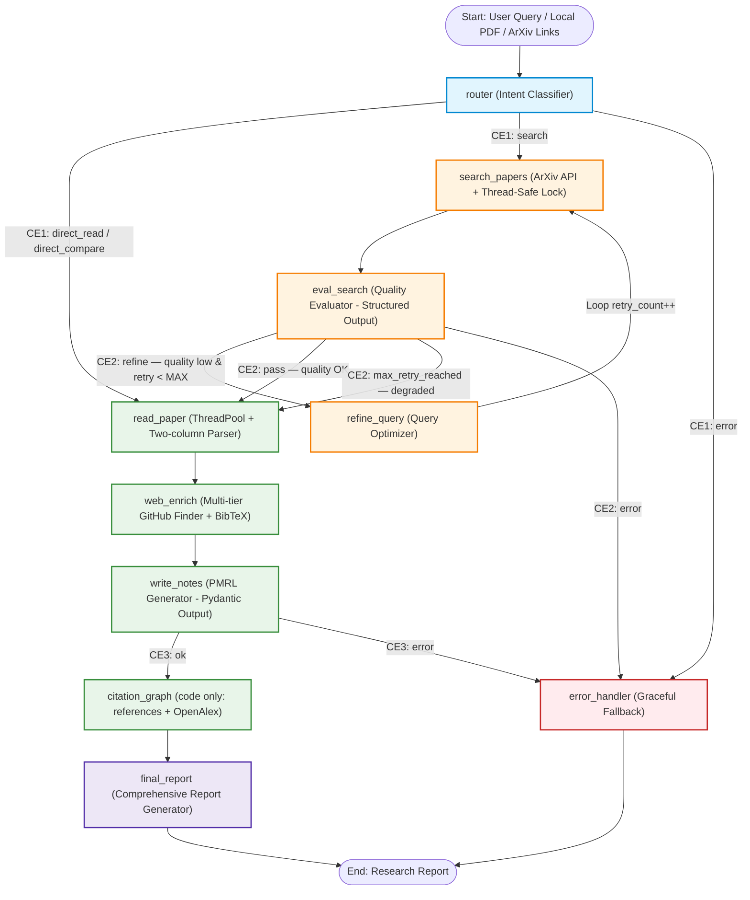

# Kiến Trúc Backend LangGraph — AI Research Paper Scout & Benchmark Assistant

> Tài liệu mô tả kiến trúc hệ thống hiện tại, sơ đồ luồng xử lý, cấu trúc dự án, và giải thích chi tiết từng thành phần mã nguồn.

---

## 1. Sơ Đồ Kiến Trúc Luồng LangGraph



### Tóm tắt luồng xử lý

| Bước | Node                  | Mô tả                                                                                         |
| :----: | :-------------------- | :---------------------------------------------------------------------------------------------- |
|   1   | `router`            | Phân loại intent (search / direct_read / direct_compare) dựa trên rule-based + LLM fallback |
|   2   | `search_papers`     | Gọi ArXiv API với rate-limit thread-safe, trả về danh sách`PaperItem`                    |
|   3   | `eval_search`       | LLM chấm điểm relevance, chọn top-K bài tốt nhất hoặc yêu cầu refine                  |
|   4   | `refine_query`      | LLM tối ưu lại từ khóa tìm kiếm dựa trên feedback → quay lại bước 2                |
|   5   | `read_paper`        | Đọc HTML trước (ar5iv → arxiv.org/html), PDF là phương án dự phòng; bóc tách sections, bảng, tài liệu tham khảo, link repo |
|   6   | `web_enrich`        | Tìm repo GitHub 3 tầng + tạo BibTeX citation                                                 |
|   7   | `write_notes`       | LLM tổng hợp ghi chú PMRL (Problem-Method-Result-Limitation)                                 |
|   8   | `citation_graph`    | Code, không LLM: dựng đồ thị trích dẫn quanh các bài đã chọn (JSON `citation_graph`)       |
|   9   | `final_report`      | LLM tổng hợp báo cáo nghiên cứu chuyên sâu, lưu file Markdown                          |
|   —   | `error_handler`     | Xử lý graceful fallback khi bất kỳ node nào gặp lỗi                                      |

---

## 2. Cấu Trúc Dự Án

```
d:\LABAI\agentresearch\
├── .env                        # API keys & cấu hình runtime
├── config.py                   # AppConfig tập trung (paths, limits, model defaults)
├── state.py                    # Pydantic models & TypedDict ResearchState
├── graph.py                    # StateGraph definition, conditional edges & checkpointer
├── app.py                      # Giao diện Streamlit (3 tabs)
├── main.py                     # CLI entry point
│
├── prompts/                    # Prompt templates tách biệt theo node
│   ├── router_prompt.py
│   ├── eval_search_prompt.py
│   ├── refine_query_prompt.py
│   ├── pmrl_notes_prompt.py
│   └── final_report_prompt.py
│
├── tools/                      # Công cụ chuyên sâu (không gọi LLM)
│   ├── arxiv_search.py         # Thread-safe ArXiv API (Lock + Exponential Backoff)
│   ├── pdf_parser.py           # Orchestrator đọc bài (HTML trước, PDF dự phòng) + PDF parser 2 cột
│   ├── html_source.py          # Tải LaTeXML HTML: ar5iv → arxiv.org/html (qua rate limiter)
│   ├── html_extractor.py       # Parse LaTeXML HTML → sections, tables, references, repo links (không mạng)
│   ├── rate_limit.py           # Limiter theo host (arxiv.org 15s, ar5iv 3s), clock/sleep inject được
│   ├── github_enricher.py      # Multi-tier GitHub search (3 fallback tiers)
│   ├── bibtex_generator.py     # Sinh BibTeX citation chuẩn
│   ├── cache_manager.py        # Canonical key + JSON/PDF cache
│   └── llm_provider.py         # Factory tạo ChatModel (Gemini/OpenAI/OpenRouter/Anthropic)
│
├── nodes/                      # Từng Node LangGraph — mỗi file 1 hàm
│   ├── router.py
│   ├── search.py
│   ├── eval_search.py
│   ├── refine_query.py
│   ├── read_paper.py
│   ├── web_enrich.py
│   ├── write_notes.py
│   ├── final_report.py
│   └── error_handler.py
│
├── tests/                      # PyTest suite
│   ├── test_tools.py
│   ├── test_nodes.py
│   └── test_graph_flow.py
│
├── data/cache/                 # Cache tự động (pdfs/ + text/)
├── reports/                    # Báo cáo Markdown đã xuất
└── docs/
    └── architecture.md         # ← File này
```

---

## 3. Giải Thích Chi Tiết Code Từng Thành Phần

### 3.1. State — Trạng Thái Toàn Cục (`state.py`)

File này định nghĩa **toàn bộ cấu trúc dữ liệu** chảy qua mọi node trong graph.

#### Pydantic Models (Dữ liệu có cấu trúc & validation tự động)

| Model                | Vai trò                                                                                                                        |
| :------------------- | :------------------------------------------------------------------------------------------------------------------------------ |
| `PMRLNotes`        | Ghi chú theo khung**P**roblem–**M**ethod–**R**esult–**L**imitation, mỗi trường là 1 đoạn văn |
| `Insight` / `EvalSetting` / `Setup` | Trường có cấu trúc của PMRL (cùng 1 lệnh gọi LLM): `insights` (finding, why_it_matters), `eval_settings` (benchmark, metric, metric_meaning, higher_is_better, unit, method_value, baseline_name/value, table_label, source_quote), `setup` (datasets, training_config, hardware, compute) và `method_name`. Mọi trường có default rỗng; cache cũ thiếu các trường này vẫn load được |
| `GitHubRepoInfo`   | Metadata repo GitHub: tên, URL, stars, framework, cờ official                                                                 |
| `PaperItem`        | Đại diện 1 bài báo xuyên suốt vòng đời: từ kết quả search → tải PDF → trích xuất → PMRL → report            |
| `PaperTable`       | 1 bảng từ HTML: `caption`, `label` ("Table 2"), `rows` (hàng header đầu tiên), `section` (heading chứa bảng)       |
| `PaperReference`   | 1 mục bibliography: `index`, `text`, `title` (ước lượng), `arxiv_id`, `doi`, `urls`                                  |
| `RepoLink`         | 1 link code/project page: `url`, `kind` (`github`/`project_page`/`other`), `context` (≤200 ký tự), `in_bibliography`, `is_primary_candidate` |
| `EvalSearchOutput` | Kết quả đánh giá chất lượng tìm kiếm:`passed`, `score`, `feedback`, `selected_indices`                        |

#### `ResearchState` (TypedDict)

Đây là **global state** của LangGraph — mỗi node nhận state này làm input và trả về `Dict[str, Any]` để merge vào state.

Điểm đặc biệt: 2 trường `trace_logs` và `error_logs` dùng **Annotated Reducer** (`operator.add`) — khi node trả về danh sách log mới, LangGraph **nối thêm** thay vì ghi đè, giúp bảo toàn toàn bộ lịch sử thực thi.

```python
trace_logs: Annotated[List[str], operator.add]   # Append-only
error_logs: Annotated[List[str], operator.add]   # Append-only
```

---

### 3.2. Cấu Hình Tập Trung (`config.py`)

Class `AppConfig` tập trung mọi hằng số cấu hình, đọc từ `.env` qua `dotenv`:

| Nhóm              | Tham số                                                        | Ý nghĩa                                                                   |
| :----------------- | :-------------------------------------------------------------- | :-------------------------------------------------------------------------- |
| **LLM**      | `DEFAULT_PROVIDER`, `DEFAULT_MODEL`                         | Provider/model mặc định (ví dụ:`gemini` / `gemini-3.1-flash-lite`) |
| **API Keys** | `GEMINI_API_KEY`, `OPENAI_API_KEY`, ...                     | Chìa khóa xác thực cho từng provider                                   |
| **ArXiv**    | `ARXIV_MIN_INTERVAL_SEC=3.0`                                  | Khoảng cách tối thiểu giữa 2 request ArXiv (tránh HTTP 429)           |
| **ArXiv metadata** | `ARXIV_METADATA_TIMEOUT_SEC=6`, `ARXIV_METADATA_MAX_ATTEMPTS=1`, `ARXIV_METADATA_GRACE_SEC=3` | Request metadata gộp 1 lần cho `read_paper`: timeout ngắn, không retry, chờ thêm tối đa 3s sau khi PDF xong |
| **Concurrency** | `READ_PAPER_MAX_WORKERS=8`, `GITHUB_MAX_CONCURRENCY=4`, `LLM_MAX_CONCURRENCY=6` | Mỗi stage dùng pool riêng; GitHub và LLM không chờ nhau |
| **Report**   | `REPORT_PARALLEL_SECTIONS=true`                                | `false` = quay lại 1 lệnh gọi LLM cũ cho toàn báo cáo                  |
| **Search**   | `MAX_RETRIES=2`, `MAX_SEARCH_RESULTS=5`, `TOP_K_PAPERS=3` | Giới hạn vòng lặp refine, số kết quả tìm kiếm, số bài chọn      |
| **PDF**      | `PDF_MAX_PAGES=8`, `PDF_MAX_CHARS=15000`                    | Giới hạn trang/ký tự khi parse PDF (đường PDF giữ nguyên cap 4000/2000 ký tự mỗi section) |
| **Pacing HTML/PDF** | `ARXIV_HOST_MIN_INTERVAL_SEC=15`, `AR5IV_MIN_INTERVAL_SEC=3` | Khoảng cách tối thiểu giữa 2 lần *bắt đầu* request tới cùng host. `arxiv.org` (cả `/html` và `/pdf`) theo `Crawl-delay: 15` trong robots.txt; ar5iv không có crawl-delay. Ghi đè bằng biến môi trường cùng tên |
| **Cap section HTML** | `HTML_EXPERIMENTS_MAX_CHARS=12000`, `HTML_METHODOLOGY_MAX_CHARS=8000`, `HTML_SETUP_MAX_CHARS=6000`, `HTML_ABSTRACT_MAX_CHARS=3000`, `HTML_LIMITATIONS_MAX_CHARS=3000` | Giới hạn ký tự mỗi section lấy từ HTML (env ghi đè được) |
| **PMRL input** | `PMRL_INPUT_MAX_CHARS=40000` | Trần ký tự text gửi cho lệnh PMRL (thay cho cắt cứng 14000). Tổng cap section HTML là 32000; bảng có nhãn nằm cuối nên bị cắt trước |
| **Paths**    | `PDF_CACHE_DIR`, `TEXT_CACHE_DIR`, `REPORTS_DIR`          | Thư mục cache và xuất báo cáo                                         |

Constructor `__init__` tự động tạo các thư mục cache nếu chưa tồn tại.

---

### 3.3. Đồ Thị LangGraph (`graph.py`)

File trung tâm gắn kết 9 node thành 1 `StateGraph` hoàn chỉnh.

#### 3 Conditional Edge Functions

```python
def route_after_router(state) -> str:
    # CE1: error → error_handler
    #       direct_read/direct_compare → read_paper (bỏ qua search)
    #       search → search_papers

def route_after_eval_search(state) -> str:
    # CE2: error → error_handler
    #       eval_passed=True → read_paper
    #       retry_count < MAX_RETRIES → refine_query (loop)
    #       hết retry → read_paper (graceful degradation)

def route_after_write_notes(state) -> str:
    # CE3: error → error_handler
    #       còn lại → citation_graph (rồi citation_graph → final_report)
```

#### `build_research_graph()`

1. **Tạo `StateGraph(ResearchState)`** — khai báo kiểu state
2. **Thêm 9 node** bằng `workflow.add_node(name, function)`
3. **Nối cạnh**: 4 cạnh cố định + 3 conditional edges (CE1, CE2, CE3) + 1 vòng lặp `refine_query → search_papers`
4. **Compile** với `MemorySaver` checkpointer (lưu snapshot state theo `thread_id`)

Kết quả trả về là 1 `CompiledGraph` object có thể gọi `.stream()` hoặc `.invoke()`.

---

### 3.4. Node: `router` (`nodes/router.py`)

**Chức năng**: Phân loại intent của người dùng thành 1 trong 3 nhánh.

**Chiến lược 2 lớp**:

1. **Rule-Based (Ưu tiên #1)** — Không cần gọi LLM, chạy tức thì:

   - Nếu `raw_inputs` có đúng 1 phần tử → `direct_read`
   - Nếu `raw_inputs` có ≥ 2 phần tử → `direct_compare`
   - Tự động phát hiện ArXiv ID (`\d{4}\.\d{4,5}`) và local PDF path
2. **LLM Classifier (Fallback)** — Cho câu hỏi tự nhiên:

   - Gọi LLM với `with_structured_output(RouterDecision)` → đảm bảo JSON output
   - Prompt yêu cầu trích xuất **từ khóa tiếng Anh học thuật** nếu câu hỏi bằng tiếng Việt
   - Ví dụ: `"Tôi muốn tìm bài báo unlearning"` → `search_query = "machine unlearning in AI"`

**Error handling**: Nếu LLM lỗi (mạng, quota) → fallback tự động về `intent="search"` với `search_query` nguyên bản.

---

### 3.5. Node: `search_papers` (`nodes/search.py`)

**Chức năng**: Gọi hàm `arxiv_search()` từ `tools/arxiv_search.py` và cập nhật `search_results`.

- Nhận `search_query` từ state (đã được router hoặc refine_query chuẩn hóa)
- Trả về danh sách `PaperItem` (title, summary, authors, arxiv_id, pdf_url)
- Nếu API lỗi → set `status="error"` để CE1 chuyển sang `error_handler`

---

### 3.6. Node: `eval_search` (`nodes/eval_search.py`)

**Chức năng**: LLM đánh giá chất lượng kết quả tìm kiếm, chọn top-K bài tốt nhất.

**Cơ chế**:

1. Format danh sách ứng viên (title, abstract, authors) thành chuỗi text
2. Gọi LLM với `with_structured_output(EvalSearchOutput)` → nhận `passed`, `score`, `feedback`, `selected_indices`
3. Dùng `selected_indices` để chọn đúng các `PaperItem` từ `search_results` → ghi vào `selected_papers`
4. Nếu LLM trả `passed=False` → CE2 sẽ route sang `refine_query`

**Fallback**: Nếu LLM lỗi → tự động chấp nhận top-K bài đầu tiên (`eval_passed=True`).

---

### 3.7. Node: `refine_query` (`nodes/refine_query.py`)

**Chức năng**: Tối ưu lại từ khóa tìm kiếm dựa trên feedback từ eval_search.

- LLM nhận `user_query` + `current_search_query` + `eval_feedback` → sinh `search_query` mới
- Tăng `retry_count` mỗi lần refine
- Dùng `extract_text_from_response()` để xử lý an toàn response content (tương thích cả chuỗi `str` lẫn `list` parts)
- CE2 kiểm tra `retry_count < MAX_RETRIES` để quyết định loop tiếp hay dừng

---

### 3.8. Node: `read_paper` (`nodes/read_paper.py`)

**Chức năng**: Đọc bài báo và trích xuất nội dung có cấu trúc — chạy **song song** bằng `ThreadPoolExecutor`. Từ PR 2, thứ tự đọc là **HTML trước, PDF sau**.

**Pipeline xử lý mỗi bài báo** (trong `sync_extract_pdf_content`):

1. **Check cache** (`data/cache/text/<key>.json`). Cache chỉ dùng lại khi `extraction_version == EXTRACTION_CACHE_VERSION` (hiện là 2) và coverage `complete`. Cache cũ (thiếu key `extraction_version`) bị bỏ qua; file PDF đã tải vẫn dùng lại.
2. **HTML trước** (chỉ với bài có `arxiv_id`, không phải `local_pdf`), theo thứ tự:
   1. `https://ar5iv.labs.arxiv.org/html/<id>`
   2. `https://arxiv.org/html/<id>`

   Nguồn bị bỏ qua (rơi xuống nguồn kế tiếp) khi: HTTP khác 200, redirect ra ngoài `/html/<id>` (ví dụ `/abs/<id>`), content-type không phải HTML, trang không có markup LaTeXML (`ltx_*`), hoặc parse không ra section nào. Mỗi lần thử ghi vào `source_quality["htmlAttempts"]` (`{"source", "status"}`). Code **không bao giờ** gọi `/e-print` hay `/src` (robots.txt cấm).
3. **PDF chỉ khi cần**: khi không có HTML, hoặc HTML thiếu `abstract`/`methodology`/`experiments`. Thứ tự nguồn PDF: cache → file local → tải từ ArXiv. HTML đủ 3 section thì **không tải PDF**.
4. **Gộp**: section nào HTML thiếu thì lấy từ PDF (HTML luôn thắng khi cả hai có). `source_quality["source"]` ghi nguồn thắng: `ar5iv` | `arxiv_html` | `pdf` | `mixed` (`mixed` = HTML + PDF điền thêm section). `sourceFormat` giữ từ vựng cũ (`html`/`pdf`/`mixed`) cho API.
5. **Lưu cache** JSON: `sections`, `source_quality`, `tables`, `references`, `repo_links`, `extraction_version`.

**Sections từ HTML** (`tools/html_extractor.py`): giữ key cũ `abstract`, `methodology`, `experiments`, `limitations` và thêm `setup`.

- Heading cấp 1 được phân loại theo từ khóa; heading số không có từ khóa (ví dụ "3 Key Design Decisions") là `methodology` trước phần experiments và `experiments` sau đó. Introduction, Related Work, Conclusion bị bỏ.
- Heading con (subsection/paragraph) chỉ ghi đè section cha khi là `setup` (Implementation Details, Training Details, Hyperparameters, Hardware, Compute, Experimental Setup/Details, Configuration) hoặc `limitations`. Nhờ vậy "A.4 Hyperparameters" trong appendix vào `setup`.
- Appendix được đọc: heading appendix có "details" hoặc từ khóa setup vào `setup`; Ablation/Results vào `experiments`.
- Câu nhắc phần cứng (GPU, TPU, A100, ...) trong `methodology`/`experiments`/`limitations` được **sao chép** lên đầu `setup` (tối đa 8 câu, 2000 ký tự).
- Math dùng `alttext` của LaTeXML (TeX → text đọc được). Bảng được ghi gọn (≤1500 ký tự/bảng) vào text của section, đồng thời có dạng cấu trúc ở `PaperItem.tables`.
- Cap ký tự lấy từ `config.HTML_*_MAX_CHARS`.

**Trường có cấu trúc** (rỗng với bài chỉ có PDF; JSON cache cũ không có các trường này vẫn load được):

- `tables`: mỗi `ltx_tabular` thành 1 `PaperTable`. `colspan`/`rowspan` lặp lại text ô trên mọi ô bị span. Bảng không có chữ hoặc chỉ 1 ô bị bỏ.
- `references`: mỗi `ltx_bibitem` thành 1 `PaperReference`; `arxiv_id` (kiểu mới và cũ, bỏ hậu tố `vN`) và `doi` lấy từ text và href.
- `repo_links`: link GitHub (chuẩn hóa về `https://github.com/<owner>/<repo>`), `*.github.io`, host code khác, và link project page có cue. `is_primary_candidate = true` khi link nằm ngoài bibliography và (nằm ở phần đầu bài: tiêu đề, tác giả, abstract, footnote đầu, hoặc context có cue mạnh như "project page", "our code", "code is available", "we release"). Link trong experiments/setup cần cue mạnh; context có "baseline", "based on", "we use", "following" thì không được tính. `source_quality["codeUrls"]` chỉ chứa repo GitHub là primary candidate.

**Pacing** (`tools/rate_limit.py`): mỗi host có **một** limiter dùng chung giữa các thread. `arxiv.org` (HTML và PDF, kể cả mỗi bước redirect) cách nhau ≥ 15s giữa 2 lần bắt đầu request và chỉ 1 kết nối tại một thời điểm; `ar5iv.labs.arxiv.org` ≥ 3s. Giữ lock suốt thời gian request nên tải body cũng tuần tự. Test dùng `rate_limit.configure(clock=..., sleep=...)` để không sleep thật (`tests/conftest.py` bật clock giả cho mọi test).

**Concurrency**:

- Pool đọc bài có `min(n_papers, READ_PAPER_MAX_WORKERS)` worker. Request tới `arxiv.org` vẫn tuần tự qua limiter 15s; ar5iv cách nhau 3s. Bài ar5iv đủ section không tải PDF, nên 3 bài thường mất vài giây thay vì vài chục giây.
- Node gọi `fetch_arxiv_metadata_batch` **1 lần** khi bắt đầu (1 request `id_list=a,b,c`, timeout `ARXIV_METADATA_TIMEOUT_SEC`, 1 lần thử, vẫn qua rate limiter, cache hit không gọi HTTP).
- Sau khi PDF xong, node chờ metadata tối đa `ARXIV_METADATA_GRACE_SEC`. Nếu chưa có, node đi theo đường "metadata lỗi" cũ và ghi `arxiv.status = "timeout"` trong `node_timings`.
- Node không join request nền (`shutdown(wait=False)`); request đến muộn vẫn ghi cache cho lần chạy sau.

---

### 3.9. Node: `web_enrich` (`nodes/web_enrich.py`)

**Chức năng**: Làm giàu mỗi bài báo với mã nguồn GitHub và BibTeX citation, đồng thời chạy PMRL (kết quả dùng lại ở `write_notes`).

**Concurrency**: hai pool riêng — GitHub `min(n, GITHUB_MAX_CONCURRENCY)` và PMRL `min(n, LLM_MAX_CONCURRENCY)`. Các lệnh gọi PMRL chạy 1 đợt, không xếp hàng sau GitHub. `node_timings.web_enrich.workerCount` = số worker PMRL. `_run_notes_in_parallel` (fallback của `write_notes`) dùng cùng giới hạn LLM.

#### GitHub Multi-tier Search (`tools/github_enricher.py`)

Tìm kiếm repo theo 3 tầng fallback, dừng ngay khi đủ kết quả:

| Tier | Query                                   | Ưu điểm                                                                 |
| :--: | :-------------------------------------- | :------------------------------------------------------------------------- |
|  1  | `"<ArXiv-ID>"`                        | Chính xác nhất — nhiều tác giả ghi ArXiv ID vào description/README |
|  2  | `<6 từ khóa từ title> paper`       | Tìm theo tên paper rút gọn                                             |
|  3  | `<Last name tác giả> <3 từ khóa>` | Tìm theo tên tác giả chính                                            |

Tự động đánh dấu `is_official=True` nếu description chứa "official" hoặc ArXiv ID.

#### BibTeX Generator (`tools/bibtex_generator.py`)

Tạo citation key theo format `{LastName}{Year}{FirstWord}` (ví dụ: `vaswani2017attention`), xuất format `@article{...}` chuẩn.

---

### 3.10. Node: `write_notes` (`nodes/write_notes.py`)

**Chức năng**: LLM tổng hợp ghi chú PMRL từ nội dung section đã trích xuất.

**Cơ chế**:

1. Ghép text: abstract, methodology, `setup`, experiments, limitations, rồi các bảng có cấu trúc (`PaperTable`, dạng gọn: dòng nhãn + caption, hàng header, các hàng). Cắt ở `PMRL_INPUT_MAX_CHARS`
2. Gọi LLM với `with_structured_output(PMRLCoreGeneration)`: 4 trường PMRL + `method_name`, `insights`, `eval_settings`, `setup`
3. **Grounding bằng code** (`ground_structured_notes`, chạy sau mỗi lần LLM và cả khi cache hit; cache lưu output thô):
   - Giữ 1 dòng `eval_settings` chỉ khi mọi số trong `method_value` (và `baseline_value` nếu có số) xuất hiện trong text nguồn hoặc ô bảng. Dòng không đạt bị loại.
   - `table_label` chỉ giữ khi bảng mang nhãn đó chứa đủ các số của dòng; `source_quote` chỉ giữ khi quote có trong nguồn.
   - `setup.hardware` và `setup.compute` bị xóa nếu text không có trong nguồn (kiểm tra token: mọi token chứa chữ số và ≥50% từ còn lại). `method_name` bị xóa nếu không có trong tiêu đề/nguồn.
   - `insights` không bị loại. Số lượng ghi ở `processing_metadata["evalSettings"]` (`proposed`, `kept`, `dropped`, `hardwareDropped`, `computeDropped`).
4. Khóa cache PMRL chứa `PMRL_NOTES_VERSION` (hiện `n2`)

**Fallback PMRL**: Nếu LLM lỗi → tạo PMRLNotes mặc định từ summary/text thô.

**Ý nghĩa kiến trúc**: Sau bước này, toàn bộ nội dung bài báo (hàng chục ngàn ký tự `extracted_text`) đã được **nén** thành ~500 từ PMRLNotes có cấu trúc. Node phía sau (`final_report`) chỉ đọc `notes` — giảm ~70% token prompt.

---

### 3.11. Node: `final_report` (`nodes/final_report.py`)

**Chức năng**: Tổng hợp mọi thông tin thành **báo cáo nghiên cứu chuyên sâu** dạng Markdown.

**Cấu trúc báo cáo**: `## 1. Tóm tắt` → `## 2. Phân tích bài báo` (PMRL) → `## 3. Bối cảnh nghiên cứu` (code, từ `citation_graph`) → `## 4. Kết luận` → `## 5. Tài liệu tham khảo`. Không còn mục so sánh/benchmark; ý định `direct_compare` chỉ còn dùng ở router để chọn nhiều bài.

**Đặc điểm**:

- Chế độ mặc định (`REPORT_PARALLEL_SECTIONS=true`): mỗi bài 1 lệnh LLM viết khối `### Tên bài` (`PAPER_SECTION_PROMPT`, chỉ nhận `_paper_breakdown` của bài đó), 1 lệnh overview viết `## 1. Tóm tắt`, `## 4. Kết luận` (`REPORT_OVERVIEW_*`; `_parse_overview` vẫn nhận số 3 cũ, bản 1 bài và nhiều bài), cộng các lệnh summary card — tất cả trong **1 pool** (`min(2n+1, 2*LLM_MAX_CONCURRENCY)` worker). H1, header mục 2, thứ tự bài, mục 3 (Bối cảnh nghiên cứu) và mục 5 (Tài liệu tham khảo) được dựng bằng code từ metadata và link đã xác minh. Lệnh section lỗi → khối dựng từ notes; overview lỗi → văn bản tối thiểu; cả hai đặt status `degraded`, không cache, và không bao giờ gọi lại lệnh đơn cũ. Timing thêm `sectionPapers` và `overviewMs`.
- `REPORT_PARALLEL_SECTIONS=false` hoặc không có bài: giữ đường cũ — gộp PMRL notes + GitHub info + BibTeX vào 1 prompt duy nhất (`FINAL_REPORT_PROMPT`)
- **Khối "Kết quả chính" (PR 3)**: LLM nhận notes kèm insights, dòng eval_settings và setup, viết các sub-bullet `Insight` (đánh số), `Đại lượng đo`, `Thiết lập`, `Nhận xét` (tiếng Anh: Insight, Metrics, Setup, Remarks). **Code** dựng bảng kết quả từ `eval_settings` đã grounding (cột: Benchmark, Metric kèm đơn vị và ↑/↓, tên phương pháp, Baseline tốt nhất; `—` khi thiếu; dòng `*Nguồn: Table N trong paper*` khi nhãn bảng đã xác minh) và chèn trước sub-bullet `Nhận xét` (hoặc cuối khối Kết quả chính nếu thiếu); bảng thụt 2 dấu cách để nằm trong mục danh sách. Nếu `setup.hardware` rỗng mà `Thiết lập` không có câu về hardware, code thêm `Hardware: paper không nêu` (tiếng Anh: `Hardware: not stated in the paper`). Không có dòng đã grounding thì không có bảng. Lệnh section lỗi → `_deterministic_paper_section` dựng cùng cấu trúc từ notes. Overview nhận insights từng bài để "Tóm tắt" nêu insight xuyên suốt các bài.
- Khóa cache báo cáo chứa chế độ; hai chế độ không dùng chung entry. Phiên bản: `PARALLEL_REPORT_VERSION = "p10"`, `SUMMARY_PIPELINE_VERSION = "v5"`; khóa cũng chứa input section và context overview nên đổi notes là đổi khóa
- Mục 3 do `_context_section()` dựng từ `state["citation_graph"]` (thiếu graph → một dòng "chưa có dữ liệu"); nội dung mục 3 nằm trong khóa cache báo cáo. Đường cũ (1 prompt) chèn mục 3 bằng `_insert_context_section()` trước `## 4.`
- Lưu file Markdown tự động vào `reports/report_{title}_{timestamp}.md`
- Dùng `extract_text_from_response()` để xử lý an toàn response từ mọi LLM provider

---

### 3.11b. Node: `citation_graph` (`nodes/citation_graph.py`)

**Chức năng**: Dựng đồ thị trích dẫn quanh các bài đã chọn bằng code (không LLM, không gọi mạng trừ OpenAlex khi có key). Chạy sau `write_notes`, trước `final_report`; không bao giờ làm run lỗi (lỗi → đồ thị rỗng + log).

- **Cạnh đi ra**: mỗi `PaperReference` của bài đã chọn được đổi thành arXiv id qua `tools/ref_resolver.py` (thứ tự: id có sẵn → DOI `10.48550/arXiv.X` → DOI trong index → tiêu đề chuẩn hóa khớp đúng 1 dòng trong index; tiêu đề < 4 từ hoặc khớp ≥ 2 dòng thì bỏ qua).
- **Cạnh đi vào**: OpenAlex (`tools/openalex.py`): 1 lệnh lấy work theo DOI arXiv, 1 lệnh lấy 50 bài trích dẫn nhiều nhất cho mỗi bài đã chọn, và số trích dẫn của các ứng viên nền tảng. Không có `OPENALEX_API_KEY` → trạng thái `no_key`, vẫn có bài nền tảng từ co-citation.
- **Bài nền tảng** = tài liệu tham khảo được ≥ 2 bài đã chọn trích dẫn (sắp theo số bài, rồi `cited_by_count`, rồi năm); chỉ 1 bài đã chọn → các tham khảo đã giải được có nhiều trích dẫn nhất (không có OpenAlex: theo thứ tự danh mục). **Bài kế thừa** = bài trích dẫn ≥ 2 bài đã chọn; nếu < 3 thì thêm các bài trích dẫn 1 bài có nhiều trích dẫn nhất. Mỗi nhóm tối đa `CITATION_TOP_N` (5); bài đã chọn không bao giờ là ứng viên.
- **State/API**: `citation_graph` = `{nodes:[{id, arxiv_id, title, year, cited_by_count, selected, role, support}], edges:[{source, target, kind:"cites"}], stats:{refs_total, refs_resolved, refs_ambiguous, by_method, openalex: "ok"|"no_key"|"error", openalex_mismatch}}`. API thêm trường `citationGraph` vào `result` (giữ nguyên tên khóa JSON như trên). `node_timings.citation_graph` ghi `durationMs`, số request và cache hit OpenAlex.
- **Tiêu đề/năm**: nút có arXiv id trong index cục bộ luôn lấy tiêu đề và năm từ index; OpenAlex chỉ cho `cited_by_count`. Nếu tiêu đề OpenAlex lệch tiêu đề index (Jaccard token < 0,5) thì bản ghi OpenAlex là sai: `cited_by_count = null` và `stats.openalex_mismatch` tăng 1. Khi đó code tìm lại đúng 1 lần theo tiêu đề index (`OpenAlexClient.work_by_title`, `search=` với tiêu đề chuẩn hóa, 5 kết quả): nhận kết quả có Jaccard ≥ 0,8, lấy `cited_by_count` cao nhất; thành công thì `stats.openalex_title_fallback` tăng 1, không thì `cited_by_count = null`. Ứng viên không có count vẫn được giữ, xếp sau mọi ứng viên có count cùng số bài trích (mục 3 bỏ phần số trích dẫn). `similarity_graph` dùng cùng quy tắc.
- **Index cục bộ** (`data/arxiv/index.sqlite`, nhánh `feat/local-index`): chỉ mở `mode=ro`, không tạo index mới. Tra tiêu đề bằng FTS5 (`title : "cụm từ"`) rồi so khớp chuẩn hóa trong Python. Tra DOI: cột `doi` không có index nên lần tra DOI đầu tiên của tiến trình quét 1 lần `WHERE doi != ''` (~160k dòng, ~0,5 s khi file đã nằm trong cache OS) vào dict trong RAM; không ghi file. Thiếu file index → chỉ dùng id có sẵn và DOI arXiv.
- **Cấu hình**: `OPENALEX_API_KEY` (env/.env), `OPENALEX_MIN_INTERVAL_SEC` (0,2), `CITATION_TOP_N` (5), `CITATION_INDEX_PATH` (mặc định `data/arxiv/index.sqlite`, hoặc `LOCAL_INDEX_PATH`). Cache OpenAlex: `data/cache/openalex/<sha256(url không có key)>.json` (không lưu key).
- Script thử offline (index thật, không OpenAlex): `.venv/bin/python -I bench/citation_graph_probe.py [thư mục]`.

#### Đồ thị tương đồng (`nodes/similarity_graph.py`, kiểu Connected Papers)

- Lưu ở `citation_graph["similarity"]`, API trả thêm `citationGraph.similarity` (chỉ khi có; khóa giữ snake_case): `{nodes:[{id, arxiv_id, title, year, cited_by_count, first_author, abstract, similarity, role:"origin"|"similar", url}], edges:[{source, target, weight}], prior_works:[… + support], derivative_works:[… + support], stats:{seeds, pool, requests, cache_hits, duration_ms, status:"ok"|"no_key"|"error"|"partial"}}`. UI sau này: cỡ nút = `cited_by_count`, màu = `year`, cạnh = `weight`, nút `origin` nổi bật.
- **Seed** = tham khảo HTML đã giải ra arXiv id (ánh xạ sang W id bằng 1 lệnh lọc DOI cho ≤ 50 id) + `referenced_works` của bài đã chọn nếu có (OpenAlex hay để trống `referenced_works` với preprint). **Pool** = bài trích dẫn từng seed và bài đã chọn (100 bài nhiều trích dẫn nhất mỗi lần), giữ `CITATION_SIMILARITY_POOL` (300) bài trích dẫn nhiều seed nhất, lấy chi tiết theo lô 50.
- **Nhận diện bài**: arXiv id lấy từ bản đồ seed W→arXiv (DOI lookup), rồi DOI OpenAlex, rồi khớp chính xác tiêu đề đã chuẩn hóa với index cục bộ (bỏ qua mơ hồ / < 4 từ). Nếu bài có trong index → `title`, `year`, `abstract` lấy từ index (`title_source: "index"`), vì tiêu đề OpenAlex của vài preprint bị sai; không có trong index nhưng là seed → tiêu đề trong danh mục HTML (`"reference"`); còn lại `"openalex"` (origin thiếu dữ liệu: `"paper"`).
- **Điểm** = cosine bibliographic coupling `|refs ∩ seeds| / √(|refs|·|seeds|)` + `CITATION_SIMILARITY_DIRECT_BONUS` (0,10) nếu bài trích dẫn trực tiếp bài đã chọn (thay co-citation thật, vì không tốn thêm request) + `CITATION_SIMILARITY_INDEX_BONUS` (0,08) nếu bài có trong index cục bộ (cs.*); bài chia sẻ < `CITATION_SIMILARITY_MIN_SHARED` (1) seed bị loại trừ khi trích dẫn trực tiếp. Giữ `CITATION_SIMILARITY_NODES` (40) bài cao nhất; `similarity` của nút = cosine thuần.
- **Cạnh** = cosine tập tham khảo giữa các nút (origin dùng seed của chính nó); mỗi nút giữ `CITATION_SIMILARITY_EDGES_PER_NODE` (4) cạnh mạnh nhất ≥ 0,05; vô hướng, mỗi cặp một lần. **Prior works** = tài liệu được các nút trích dẫn nhiều nhất (top 10); **derivative works** = bài trong pool trích dẫn nhiều nút nhất (top 10, tính từ dữ liệu đã lấy).
- **Lọc prior/derivative**: bỏ bài không xác minh được (không có arXiv id sau khi khớp DOI/tiêu đề, `referenced_works` rỗng và `title_source == "openalex"`); số bài bỏ ghi ở `stats.unverified_dropped`; danh sách được bù cho đủ 10.
- **Ngân sách**: `CITATION_SIMILARITY_BUDGET_SEC` (60 s, đồng hồ thật; tính cả các lần tra tiêu đề trong index cục bộ) — hết giờ thì dừng gọi request và tra index và trả đồ thị `partial` từ dữ liệu đang có. Request lỗi cũng cho `partial` (hoặc `error` nếu chưa có gì). Tắt hẳn: `CITATION_SIMILARITY_ENABLED=false`. Node không bao giờ raise.
- Probe thật (cần mạng + key): `.venv/bin/python -I bench/similarity_graph_probe.py <arxiv_id> [--out file.json]`. Test offline: `tests/test_similarity_graph.py`.

---

### 3.12. Node: `error_handler` (`nodes/error_handler.py`)

**Chức năng**: Bắt mọi trạng thái lỗi (`status="error"`) và tạo báo cáo fallback thay vì crash.

Báo cáo fallback chứa: lý do lỗi, query gốc, intent, số lần retry — giúp người dùng tự debug.

---

### 3.13. Tools Layer

#### `tools/arxiv_search.py` — Thread-safe ArXiv API

| Thành phần             | Chi tiết                                                                                    |
| :----------------------- | :------------------------------------------------------------------------------------------- |
| `_ARXIV_LOCK`          | `threading.Lock()` — serialize mọi request ArXiv giữa các thread                       |
| `_rate_limit_arxiv()`  | Đảm bảo ≥ 3s giữa 2 request, thêm jitter ngẫu nhiên (0.1–0.4s)                      |
| `fetch_arxiv_metadata_batch()` | 1 request `id_list` cho nhiều bài (timeout/attempt riêng, ghi cache từng id)     |
| `_arxiv_get()`         | Retry tối đa 3 lần với**Exponential Backoff** (3s → 6s → 12s+) khi gặp HTTP 429 |
| `_clean_arxiv_query()` | Loại bỏ stopwords tiếng Anh + tiếng Việt, format`all:term1 AND all:term2`             |
| `STOPWORDS`            | Bao gồm cả`"toi", "muon", "tim", "bai", "bao", "trong"` — hỗ trợ query tiếng Việt   |

#### `tools/pdf_parser.py` — Orchestrator đọc bài + PDF Parser

- **`sync_extract_pdf_content()`**: Orchestrator: cache check → HTML (ar5iv → arxiv.org/html) → PDF nếu cần → gộp → save cache
- **`_download_pdf()`**: mỗi request (kể cả redirect) lấy 1 slot từ limiter `arxiv.org`
- **`extract_ordered_blocks_from_pdf()`**: Dùng PyMuPDF `page.get_text("blocks")` → chia cột trái/phải theo `mid_x` → sắp xếp theo reading order
- **`parse_structured_sections()`**: Regex bóc tách 4 section chính, fallback cắt text thô nếu regex không match

#### `tools/html_source.py` — Tải HTML

- **`fetch_html_extraction()`**: thử ar5iv rồi arxiv.org/html, trả `(HTMLExtraction, source)`; ghi `htmlAttempts`
- **`fetch_html_page()`**: GET không tự redirect; chỉ theo redirect tới `/html/<id>` trên host cho phép (`ar5iv.labs.arxiv.org`, `arxiv.org`), tối đa 3 hop, giới hạn 20 MB, mỗi hop qua limiter

#### `tools/html_extractor.py` — Parse LaTeXML (không mạng, chỉ stdlib `html.parser`)

- **`extract_html()`** → `HTMLExtraction` (`sections`, `tables`, `references`, `repo_links`, `code_urls`); **`looks_like_latexml()`** phát hiện trang không có nội dung LaTeXML
- Script thử offline: `.venv/bin/python -I bench/html_extract_probe.py [thư mục]` (mặc định `data/arxiv/html_probe`)

#### `tools/rate_limit.py` — Limiter theo host

- **`host_slot(host)`**: context manager; no-op với host ngoài `arxiv.org`/`www.arxiv.org`/`ar5iv.labs.arxiv.org`
- **`configure(clock=, sleep=)`**: reset trạng thái và inject clock giả (dùng trong test)

#### `tools/cache_manager.py` — Hệ Thống Cache

| Hàm                         | Chức năng                                                                          |
| :--------------------------- | :----------------------------------------------------------------------------------- |
| `canonicalize_paper_key()` | Sinh key chuẩn:`arxiv_1706.03762` / `local_filename_a1b2c3` / `id_query_hash` |
| `get_cached_pdf_path()`    | Kiểm tra PDF đã tải chưa                                                        |
| `get_cached_text_data()`   | Đọc JSON cache (sections, extracted_text, source_quality, tables, references, repo_links, `extraction_version`) |
| `save_cached_text_data()`  | Lưu kết quả parse vào JSON cache                                                 |

#### `tools/llm_provider.py` — LLM Factory

| Hàm                             | Chức năng                                                                                                       |
| :------------------------------- | :---------------------------------------------------------------------------------------------------------------- |
| `get_llm()`                    | Factory tạo`BaseChatModel` theo provider: Gemini, OpenAI, OpenRouter, Anthropic                                |
| `extract_text_from_response()` | Xử lý an toàn`response.content` — tương thích cả `str` lẫn `list[ContentPart]` từ Gemini SDK mới |

---

### 3.14. Prompts Layer (`prompts/`)

Mỗi call LLM gửi **2 message**: `X_SYSTEM` (tĩnh: vai trò, luật, định dạng, ngân sách từ) và `X_USER` (biến: dữ liệu trong thẻ như `<paper_source>`, `<pmrl_notes>` + nhiệm vụ cụ thể). System prompt nói 1 lần rằng nội dung trong thẻ là dữ liệu, không phải chỉ dẫn. Luật viết báo cáo dùng chung (ngôn ngữ, LaTeX `$$`, không `<br>`, không nhãn nội bộ, cảnh báo trích xuất, không bịa link) nằm 1 lần trong `prompts/common.py`.

| File                       | Biến                                                  | Dùng cho                                                                  |
| :------------------------- | :----------------------------------------------------- | :------------------------------------------------------------------------- |
| `common.py`              | `DATA_TAG_RULE`, `REPORT_WRITING_RULES`              | Luật dùng chung                                                           |
| `router_prompt.py`       | `ROUTER_SYSTEM` / `ROUTER_USER`                    | `router`                                                                  |
| `eval_search_prompt.py`  | `EVAL_SEARCH_SYSTEM` / `_USER`                     | `eval_search`                                                             |
| `refine_query_prompt.py` | `REFINE_QUERY_SYSTEM` / `_USER`                    | `refine_query`                                                            |
| `pmrl_notes_prompt.py`   | `PMRL_NOTES_SYSTEM` / `_USER`                      | `write_notes` (schema `PMRLCoreGeneration`, không có `brief_summary`)    |
| `results_summary_prompt.py` | `RESULTS_SUMMARY_SYSTEM` / `_USER`              | 5 summary card                                                            |
| `final_report_prompt.py` | `PAPER_SECTION_*`, `REPORT_OVERVIEW_*`, `REPORT_OVERVIEW_SINGLE_*`, `FINAL_REPORT_PROMPT` (cũ) | `final_report` song song / đường cũ 1 chuỗi |

Builder thuần (không đọc cache), dùng chung bởi production và `bench/prompt_bench.py`: `write_notes.build_pmrl_messages`, `final_report.build_cards_messages`, `build_section_messages`, `build_overview_messages` — đều trả `(system, user)`.

`tools/llm_provider.py`: `invoke_structured_output(prompt, schema, system=None)` — không có `system` thì request là 1 chuỗi như cũ; có `system` thì gửi `[SystemMessage, HumanMessage]` (Z.AI: JSON Schema nối vào system). `invoke_text(llm, system, user)` cho call văn bản. Gemini map `SystemMessage` đầu tiên sang `system_instruction`, Anthropic sang tham số `system`, OpenAI-compatible sang role `system` (đã kiểm tra trong source đã cài).

------------------------- | :-------------------------- | :------------------------------------------------------------ |
| `router_prompt.py`       | `ROUTER_SYSTEM_PROMPT`    | `router` — phân loại intent, trích từ khóa tiếng Anh |
| `eval_search_prompt.py`  | `EVAL_SEARCH_PROMPT`      | `eval_search` — chấm điểm & chọn bài                  |
| `refine_query_prompt.py` | `REFINE_QUERY_PROMPT`     | `refine_query` — tối ưu từ khóa                        |
| `pmrl_notes_prompt.py`   | `PMRL_NOTES_PROMPT`       | `write_notes` — tổng hợp PMRL                            |
| `final_report_prompt.py` | `FINAL_REPORT_PROMPT` (+ `PAPER_SECTION_PROMPT`, `REPORT_OVERVIEW_PROMPT`) | `final_report` — báo cáo 1 lệnh (cũ) hoặc theo từng phần song song |

---

### 3.15. Entry Points

#### `main.py` — CLI

```bash
# Tìm kiếm theo chủ đề
python main.py --query "Diffusion Models in Medical Imaging"

# So sánh 2 bài báo cụ thể
python main.py --inputs "1706.03762" "2005.14165"

# Override model
python main.py --query "machine unlearning" --provider gemini --model gemini-3.6-flash
```

Chạy `graph.stream()` đồng bộ, in trace log từng bước, xuất final report ra terminal.

#### `app.py` — Streamlit Web UI

Giao diện 3 tabs:

| Tab                       | Nội dung                                         |
| :------------------------ | :------------------------------------------------ |
| 📄 Báo Cáo Tổng Hợp   | Markdown report + nút Download                   |
| 📝 Ghi Chú PMRL & GitHub | Card từng bài: PMRL notes, GitHub repos, BibTeX |
| ⏱️ Nhật Ký Thực Thi  | Trace logs real-time từng node                   |

Sidebar cho phép chọn LLM provider/model, override API keys, xem sơ đồ luồng xử lý.

---

### 3.16. Tests (`tests/`)

| File                   | Số tests | Phạm vi                                                                       |
| :--------------------- | :-------: | :----------------------------------------------------------------------------- |
| `test_tools.py`      |     3     | `canonicalize_paper_key`, `generate_bibtex`, `parse_structured_sections` |
| `test_nodes.py`      |     3     | `router_node` (1 link, multi links), `error_handler_node`                  |
| `test_graph_flow.py` |     2     | Graph compilation, routing logic (CE1/CE2/CE3)                                 |
| `test_html_extraction.py` |  69  | Parse HTML giả (section, appendix setup, bảng colspan, bibitem, repo link primary/baseline), thứ tự fallback với HTTP mock, limiter với clock giả, cache version |

| `test_results_format.py` |  4  | Grounding loại số/hardware bịa, cache PMRL cũ vẫn load, bảng kết quả chèn trước `Nhận xét`, dòng hardware "không nêu" |
| `test_bench_verify.py` |  +2  | `results_format` (Insight/Đại lượng đo/Thiết lập) và `results_table_numbers` (số trong bảng có trong nguồn) |

Chạy: `.venv/bin/python -m pytest tests/ -q`.

Xem trước định dạng báo cáo, hoàn toàn offline (LLM giả, số thật từ bảng đã parse): `.venv/bin/python -I bench/render_report_preview.py` → `data/arxiv/preview_report.md` (đọc `data/arxiv/html_probe/ar5iv_*.html`).
