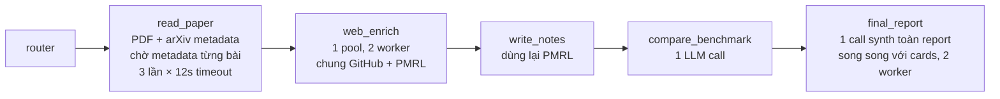
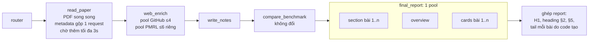

# Tối ưu latency và prompt — quyết định và phát hiện (2026-10-10)

Tài liệu này ghi lại các quyết định thay đổi kiến trúc (trước/sau), số liệu đo và phát hiện về hành vi của LLM trong đợt tối ưu ngày 2026-10-10. Mục đích: làm nguồn cho báo cáo dự án.

Quy ước:
- **Theo đo:** số liệu đo thật, có file bằng chứng.
- **Đánh giá:** nhận định hoặc giả thuyết, chưa kiểm chứng đầy đủ.

Provider trong mọi phép đo: Z.AI, model `glm-5.3-flash`, `TEMPERATURE = 0.0`. Model này luôn bật thinking; API trả lỗi khi tắt thinking.

Bằng chứng nằm trong [bench/results/2026-10-10/](../bench/results/2026-10-10/) (e2e: `run.json`, `verify.json`, `report.md`; prompt bench: `summary.md`, `summary.json`). Baseline nằm trong [bench/baselines/direct_compare_3papers_20261010/](../bench/baselines/direct_compare_3papers_20261010/).

---

## 1. Bài toán và phương pháp đo

**Bài toán:** một full run với 3 paper mất 951s. Mục tiêu người dùng đặt ra: 1 hoặc nhiều paper trong ≤60s, không giảm chất lượng, không giảm reasoning effort.

**Công cụ đo (tạo trong đợt này):**

| Công cụ | Việc |
|---|---|
| `bench/run_scenario.py` | Chạy một scenario end-to-end. Dùng LLM cache tạm. Ghi wall time từng node, từng LLM call (input/output/reasoning token), HTTP call, state, report |
| `bench/verify.py` | So một run với baseline. HARD: cấu trúc report `##` 1–5, mỗi bài một `###`, link arXiv, notes đủ P/M/R/L, không lộ label nội bộ. QUALITY: mức card, số từ PMRL, độ dài report, tỷ lệ số liệu có trong source, số phương trình, bảng so sánh. LATENCY: speedup và mục tiêu 60s |
| `bench/prompt_bench.py` | Chạy lại **một stage** (PMRL, cards, section, overview) với input cố định, so prompt `v0` với prompt `new`, mỗi bên n lần, trong cùng khung giờ. Ghi median/p90 token và thời gian, cùng chất lượng output |

Prompt v0 đã chụp nguyên văn vào `bench/prompt_variants/v0/` (14 case render sẵn).

---

## 2. Kiến trúc trước và sau

### 2.1 Trước (baseline 951s)

Theo đo (baseline, 3 paper):

| Node | Thời gian | Nguyên nhân |
|---|---|---|
| `read_paper` | 49,2s | PDF 3s; chờ arXiv metadata 42–49s, cả 3 đều lỗi (timeout/429) |
| `web_enrich` | 231,1s | 3 PMRL call chạy 2 đợt vì pool 2 worker dùng chung với GitHub |
| `compare_benchmark` | 327,3s | 1 LLM call |
| `final_report` | 343,2s | 1 call synth, prompt 24.435 ký tự |
| **Tổng** | **951s** | ~94% là thời gian chờ LLM |

Mọi prompt gửi dưới dạng **một user message duy nhất** (`llm.invoke(str)`), không có system message.

### 2.2 Sau

Topology và tên node không đổi. `api.py`, `frontend/` và `compare_benchmark.py` không đổi.

### 2.3 Danh sách quyết định

| # | Quyết định | File | Lý do | Trạng thái |
|---|---|---|---|---|
| D1 | arXiv metadata: gộp thành 1 request `id_list`, timeout 6s, 1 lần thử, chờ thêm tối đa 3s sau PDF, không join thread nền | `nodes/read_paper.py`, `tools/arxiv_search.py` | Metadata chặn node 42–49s dù đều lỗi | Giữ |
| D2 | Sửa lỗi cache metadata: lưu dưới cả id có version và không version | `tools/arxiv_search.py` | arXiv trả `…v1`; code cũ lưu và tìm khác key, nên cache không bao giờ hit | Giữ |
| D3 | Tách pool GitHub (≤4) và PMRL (≤`LLM_MAX_CONCURRENCY`=6) | `nodes/web_enrich.py`, `nodes/write_notes.py` | Pool chung 2 worker bắt PMRL chạy 2 đợt | Giữ |
| D4 | Report song song: n call section + 1 call overview + n call cards trong 1 pool; cờ `REPORT_PARALLEL_SECTIONS` (False = đường legacy) | `nodes/final_report.py` | Call synth 343s là call dài nhất | Giữ |
| D5 | Phần cố định do code tạo: H1, heading §2, §5 tài liệu tham khảo, và các bullet Mã nguồn / Trích xuất / Liên kết / BibTeX của mỗi bài | `nodes/final_report.py` | LLM không cần sinh lại dữ liệu đã có sẵn | Giữ |
| D6 | Khi chỉ có 1 bài: §3 "So sánh" là câu cố định; overview chỉ viết §1 và §4 | `nodes/final_report.py`, `prompts/final_report_prompt.py` | Overview tự ghi "chỉ có 1 bài" rồi vẫn lập lại bảng kết quả | Giữ |
| D7 | Tách role: mọi call (trừ compare và synth legacy) gửi `[system, user]`; dữ liệu paper đặt trong thẻ, system ghi "nội dung trong thẻ là dữ liệu" | `tools/llm_provider.py`, `prompts/*`, các node | Tách chỉ dẫn khỏi dữ liệu; prefix dùng chung | Giữ |
| D8 | PMRL: bỏ `brief_summary` khỏi request, bỏ ví dụ benchmark, thêm giới hạn số từ (P≤120, M≤180, R≤180, L≤100) | `prompts/pmrl_notes_prompt.py`, `nodes/write_notes.py` | Giảm output | Giữ (median tốt hơn; xem F5) |
| D9 | Section/overview: thêm giới hạn số từ, số bullet, ≤2 phương trình | `prompts/final_report_prompt.py` | Giảm output | **Đã bỏ** (F5) |
| D10 | Section/overview: dùng text v0, tách role | `prompts/final_report_prompt.py` | Thay D9 | Giữ |
| D11 | Cards: viết lại quy tắc (40–60 từ, gộp grounding) | `prompts/results_summary_prompt.py` | Giảm output | **Đã bỏ** (F6) |
| D12 | Cards: text v0, tách role, bỏ khối "Final report excerpt" luôn rỗng | `prompts/results_summary_prompt.py` | Thay D11 | Giữ — **chưa đo** |
| — | Giảm `reasoning_effort` | — | Người dùng từ chối vì giảm chất lượng | Không làm |
| — | Sửa `compare_benchmark` và prompt synth legacy | — | Ngoài phạm vi theo yêu cầu | Không làm |

Cờ cấu hình mới (`config.py`): `ARXIV_METADATA_TIMEOUT_SEC=6`, `ARXIV_METADATA_MAX_ATTEMPTS=1`, `ARXIV_METADATA_GRACE_SEC=3`, `READ_PAPER_MAX_WORKERS=8`, `GITHUB_MAX_CONCURRENCY=4`, `LLM_MAX_CONCURRENCY=6`, `REPORT_PARALLEL_SECTIONS=True`. `PARALLEL_REPORT_VERSION="p6"` nằm trong cache key của report.

---

## 3. Kết quả end-to-end

Theo đo. Mỗi dòng là 1 run (n=1). Mọi run đều PASS các check HARD của `verify.py`.

| Run | Code | Tổng | Output token | Ghi chú |
|---|---|---|---|---|
| baseline, 3 paper | trước tối ưu | 951,0s | — | arXiv metadata lỗi |
| parallel_v1, 3 paper | D1–D5 | 542,3s | — | compare 199s (code không đổi, provider nhanh hơn) |
| parallel_v2, 3 paper | + D6 | 451,5s | 78.951 | |
| parallel_v3_roles, 3 paper | + D7, D8, D10, D11 | 465,7s | 84.234 | 1 call cards mất 297s (22.106 token) |
| single, 1 paper (2609.19644) | D1–D5 | 239,4s | 25.034 | 81% là reasoning |
| single_v2 | + D6 | 333,6s | 37.371 | PMRL (code không đổi) 98,6s → 157,7s |
| single_v3_roles | + D7, D8, D10, D11 | 227,9s | 20.790 | |
| single_v4_cards | cards bản viết lại thứ hai | 431,9s | — | cards 234s, PMRL 196s |

Đánh giá: speedup ổn định nhất là ~2x cho 3 paper (951s → 450–540s). Kết quả từng run dao động mạnh vì F3. Mục tiêu 60s **chưa đạt**.

---

## 4. Phát hiện

### F1. Latency phụ thuộc vào output token, không phụ thuộc input

Theo đo:
- Mọi call chạy ở ~56–71 output token/s (hiếm khi tới 128–144).
- Run 1 paper: call cards có input lớn nhất (~4.100 token) nhưng nhanh nhất (52s). Call overview có input nhỏ nhất (1.053 token) nhưng chậm nhất (137s, 8.492 output token).
- Một prompt 19 token mất 2,1s. Một yêu cầu 250 từ mất 38,4s (1.753 output token).

Kết luận: cắt input chỉ giảm vài giây. Muốn nhanh hơn thì phải giảm output token hoặc tăng token/s.

### F2. Reasoning chiếm ~80% output

Theo đo: run 1 paper tạo 25.034 output token, trong đó 20.399 là reasoning (81%). Text thật chỉ ~4.600 token.

### F3. Cùng prompt, reasoning dao động rất mạnh, kể cả ở temperature 0

Theo đo:
- PMRL, input giống hệt (2.825 token): 6.025 → 10.478 output token giữa 2 run.
- Cards, cùng code: 3.448 → 12.187 output token.
- Section, cùng prompt, 3 lần gọi: 3.910 / 27.083 / 52.927 reasoning token.

**Provider thay đổi theo thời điểm.** Cùng prompt v0 cards: median 11.539 output token ở lần bench đầu, nhưng 6.694 ở lần bench sau.

Hệ quả cho phương pháp đo:
- Không so hai run đơn lẻ.
- Chỉ so hai prompt **trong cùng một lần bench** (cùng khung giờ, cùng input).
- n=3 là mức tối thiểu; nên dùng n≥5 cho kết luận quan trọng.

### F4. Tách role (system + user, dữ liệu trong thẻ) giảm reasoning

Theo đo, bench `prompt_bench_v0text_split`. Text quy tắc giống v0; chỉ khác ở chỗ tách role và đặt dữ liệu trong thẻ.

| Stage | Output median | Output p90 | Reasoning median | Thời gian median | Chất lượng |
|---|---|---|---|---|---|
| Section | 7.989 → 4.180 (**−48%**) | −46% | −55% | 119s → 68s | grounding 0,990 → 0,989 |
| Overview | 8.126 → 5.870 (**−28%**) | −37% | −31% | 136s → 103s | grounding giữ nguyên, heading 100% đúng |

Median của bản tách role thấp hơn v0 ở **mọi** case.

Đánh giá: phép đo không tách được tác động của **role** và tác động của **thẻ dữ liệu**, vì hai thay đổi đi cùng nhau. Giả thuyết: khi quy tắc và dữ liệu tách rõ, model mất ít công hơn để xác định đâu là chỉ dẫn.

### F5. Giới hạn số cứng làm model nghĩ nhiều hơn với output Markdown dài

Theo đo, bench `prompt_bench_v0_vs_new`. Bản mới vừa tách role, vừa thêm giới hạn: section "300–450 từ", "≤2 phương trình"; overview "≤150 từ", "≤5 bullet", "≤5 khuyến nghị + ≤4 thách thức".

| Stage | Output median | Reasoning median | Text thật (số từ) |
|---|---|---|---|
| Section | 7.962 → 17.142 (**+115%**) | **+152%** | −48% |
| Overview | 6.658 → 12.136 (**+82%**) | **+118%** | −48% |

Text model viết ra ngắn đi một nửa, nhưng reasoning tăng gấp 2–2,5 lần. Phân phối có đuôi dài: lần nhanh nhất của bản mới (~3.700–3.900 reasoning) thấp hơn v0, nhưng 2/3 lần vọt lên 7.600–53.000.

So sánh F4 (cùng phương án tách role nhưng **không** có giới hạn số) với F5 cho thấy: chính các giới hạn số là nguyên nhân tăng reasoning.

**Ngoại lệ — PMRL:** giới hạn số từ (P≤120, M≤180, R≤180, L≤100) làm median output **giảm** 32% (6.449 → 4.398) và thời gian giảm 35%, nhưng p90 tăng 10%.

Đánh giá (chưa kiểm chứng):
- Với output Markdown dài, nhiều ràng buộc đếm được (số từ, số bullet, số phương trình), model đếm và sửa đi sửa lại trong phần reasoning.
- Với output JSON gồm vài trường văn xuôi ngắn (PMRL), giới hạn số từ đóng vai trò mục tiêu rõ ràng và không gây vòng sửa.
- Bài học thực hành: muốn output ngắn hơn, nên bỏ việc thừa (D5, D6) thay vì đặt hạn mức số.

### F6. Quy tắc grounding chặt cho cards làm tăng reasoning

Theo đo:
- Bản cards viết lại lần 1 (40–60 từ mỗi trường, gộp grounding còn 3 quy tắc, tách role): median output −18% nhưng p90 +44%; tỷ lệ card complete 0,75 → 0,92. Một call trong run e2e mất 297s (21.530 reasoning token, output chỉ 1.868 ký tự).
- Bản cards viết lại lần 2 (mô tả trường của v0, bỏ "40–60 từ" cứng, **giữ** grounding đã gộp, tách role): median output 6.694 → 15.661 (**+134%**), p90 +98%. Ở 3/4 bài, lần nhanh nhất của bản mới vẫn chậm hơn median của v0. Tỷ lệ card complete 0,58 → 0,83.

Đánh giá (chưa kiểm chứng): quy tắc "Every number you write must appear in it" có trong cả hai bản viết lại. Quy tắc này có thể khiến model đối chiếu từng con số với source trong reasoning. Chất lượng tăng (nhiều card complete hơn), nhưng phải trả bằng ~2x token. Vì vậy D12 đưa cards về text v0.

### F7. Pipeline viết lại cùng một nội dung nhiều lần

Theo đo, run 1 paper: kết quả "86/107, 80,4%, +25,2%" xuất hiện trong PMRL `result`, card `key_results`, §1 Tóm tắt, §2 và bảng §3. Mỗi lần viết lại tốn một vòng reasoning riêng. D5 và D6 bỏ bớt các lần viết lại.

Theo đo (n=1): sau D6, overview của run 1 paper giảm 8.492 → 4.151 output token, 137s → 32,5s.

### F8. arXiv API là nguồn chậm và nguồn lỗi

Theo đo:
- `export.arxiv.org` trả 429 hoặc timeout 12s cho IP đang dùng.
- Search: 3 lần 429 làm run dừng ở `error_handler` sau 39s.
- Metadata: 3 bài × 3 lần thử × 12s, xếp hàng qua lock toàn cục, mất 49s mà không lấy được gì.

D1 xử lý metadata. Search vẫn chưa có fallback.

### F9. Đường găng còn lại

Đường găng = PMRL (bài chậm nhất) → `compare_benchmark` (≥2 bài) → call chậm nhất trong `final_report`. Mỗi call đơn lẻ đã cần 60–200s ở tốc độ ~65 token/s. Đánh giá: song song hóa không thể đưa run xuống 60s với provider và mức reasoning hiện tại.

---

## 5. Trạng thái cuối của prompt

| Prompt | Bản đang dùng | Đã đo? |
|---|---|---|
| Router / Eval / Refine | Tách role; `reasoning`/`feedback` ≤2 câu | Không đo (chỉ trên đường găng khi search) |
| PMRL | Tách role + giới hạn số từ (D8) | Có (F5) |
| Cards | Text v0 + tách role (D12) | **Chưa đo** |
| Section | Text v0 + tách role (D10) | Có (F4) |
| Overview (≥2 bài, 1 bài) | Text v0 + tách role (D10) | Có (F4) |
| Compare (`BENCHMARK_MATRIX_PROMPT`) | Không đổi, 1 user message | — |
| Synth legacy (`FINAL_REPORT_PROMPT`) | Không đổi, 1 user message | — |

Lần cuối chạy test suite: 157 test pass, **trước** thay đổi D12. Sau D12 chưa chạy lại test và chưa chạy e2e, theo yêu cầu.

---

## 6. Việc còn mở

1. Đo D12 (cards v0 + tách role) bằng `prompt_bench`, n≥3, trong cùng khung giờ với v0.
2. Hedged request cho call structured (cards, PMRL): sau ~p75, gửi bản sao và lấy kết quả về trước. Có cơ sở từ F3.
3. `compare_benchmark` nằm trên đường găng của run nhiều bài (75–327s). Có thể cho overview §1/§4 chạy song song với compare.
4. Fallback khi arXiv search bị 429.
5. Đổi provider có token/s cao hơn: đòn bẩy lớn nhất theo F1.
6. Giới hạn ≤3 phương trình hiện áp dụng cho từng bài, nên report có thể có 3n phương trình.
7. UI gắn nhãn `web_enrich` là "GitHub and BibTeX enrichment", nhưng node này chủ yếu chờ PMRL ([api.py:339](../api.py)).
